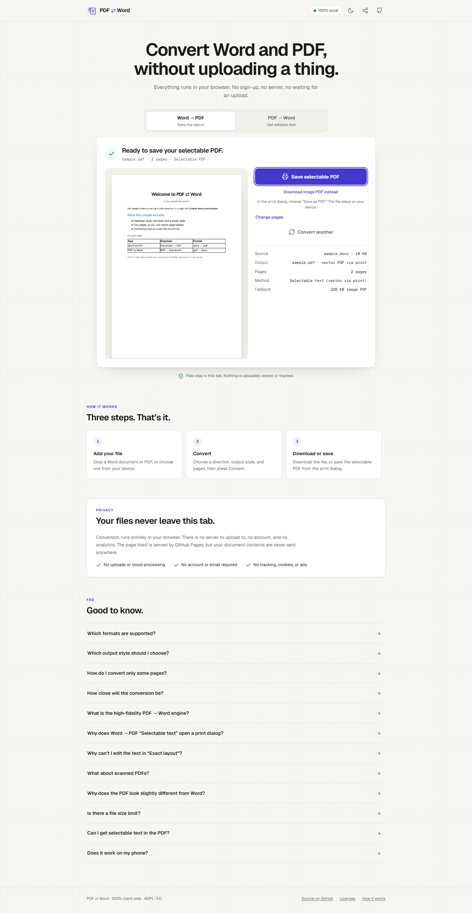
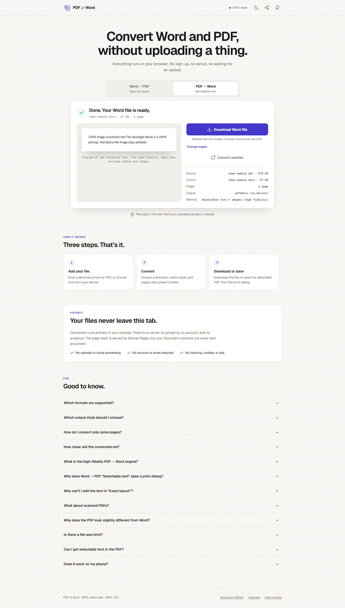
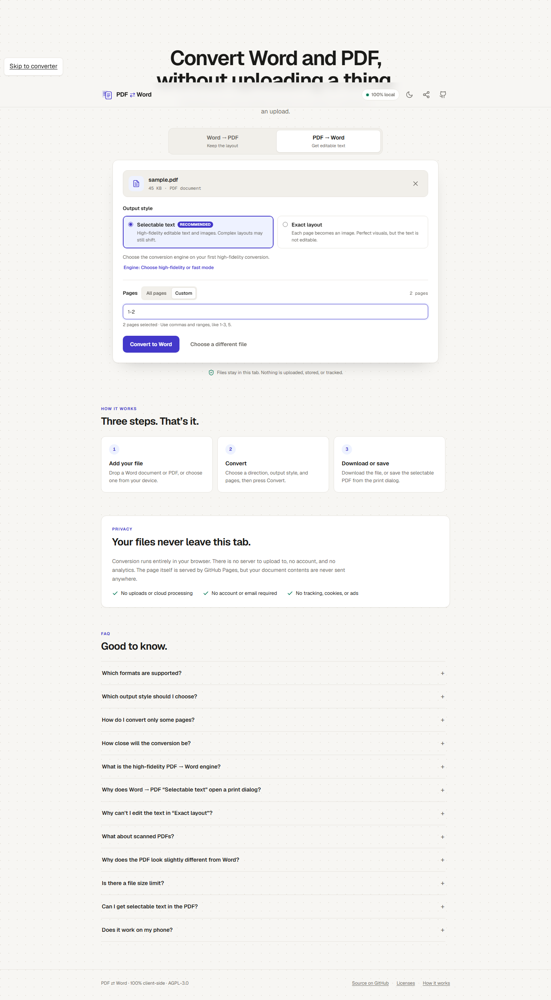

# PDF ⇄ Word

A fast, private Word ↔ PDF converter that runs entirely in your browser.

**Live app:** https://andrewung2009.github.io/pdf-word-converter/  
**Source:** https://github.com/andrewung2009/pdf-word-converter


### Word → PDF with selectable text



### PDF → Word with high fidelity



## Why this exists

Most online converters upload your documents to a server. This one doesn't. The app is a static site hosted on GitHub Pages, and every conversion happens inside your browser tab. No account, no uploads, no tracking, no ads, no per-use limits.

## Features

- **Two matching output styles in both directions** — Selectable text and Exact layout.
- **Custom pages in both directions** — convert all pages, or ranges like `1-3, 5, 8-10`. The selection applies to fast, high-fidelity, exact, and print outputs.
- **Word → PDF**
  - Selectable: preview, then save a true vector PDF through your browser's print dialog. Images and layout are preserved, and the text is selectable.
  - Exact: automatically download a page-perfect image PDF with a searchable text layer.
- **PDF → Word**
  - Selectable: use the optional on-device high-fidelity engine (pdf2docx) for editable text, tables, and images, with a fast fallback.
  - Exact: each page becomes an image; perfect visuals, but text is not editable.
- **High-fidelity engine runs locally** — the first Selectable PDF → Word conversion offers a one-time ~50–55 MB download, cached by the browser. Files never leave the device.
- **Share button** — Web Share where available, or copy the app link.
- **Friendly edge cases** — encrypted PDFs, scanned-PDF detection, legacy `.doc` guidance, size warnings, cancelable conversions, and clear errors.
- **Light and dark themes**, responsive layout, keyboard support, and reduced-motion support.
- **Works at any GitHub Pages path** — relative asset URLs.

### Custom pages



## How to use

1. Pick a direction: **Word → PDF** or **PDF → Word**.
2. Drop a `.docx` or `.pdf` file, or choose one. You can also try the bundled sample.
3. Pick an output style and, optionally, a custom page range, then press **Convert**.
4. Download the result, or save the selectable PDF from the print dialog.

PDF → Word creates a new `.docx` you can open in Microsoft Word, Google Docs, LibreOffice, or Pages.

## How it works

### Word → PDF

The `.docx` is rendered in the browser with `docx-preview`, using metric-compatible fonts where possible.

- **Selectable text** opens the browser print dialog. Choosing “Save as PDF” gives genuine vector text and images without a server.
- **Exact layout** captures each rendered page at high resolution and assembles an image PDF with `jsPDF`. An invisible text layer makes it searchable for Latin scripts.

Because browsers cannot produce a vector PDF from a Word layout without a server or Office engine, the Exact download is image-based. Use the print route for true vector text.

### PDF → Word

The fast converter uses `pdf.js` to extract text and images, then reconstructs paragraphs, headings, lists, and images with the `docx` library. Layout is approximate.

The optional high-fidelity engine uses **pdf2docx** (PyMuPDF) compiled to WebAssembly through Pyodide. It runs in a separate local iframe/worker, reconstructs flowing text, tables, and images, and returns a `.docx`. It is best-effort: complex layouts can still shift, and the engine downloads once on first use. Unusual image color spaces such as CMYK are normalized before embedding, so a single problematic image does not abort the conversion.

Scanned PDFs have no selectable text; the app detects this and offers **Exact layout**, which embeds each page as an image. OCR is not included.

## Privacy

- Files are read with the browser's `File` APIs and never leave the device.
- There is no backend and no upload endpoint.
- The high-fidelity engine is downloaded from this site and executed locally.
- No cookies, analytics, ads, or third-party trackers.
- Only the theme, last-used mode, output style, and engine preference are saved in `localStorage`.
- The app is a static bundle served by GitHub Pages.

## Supported formats and limits

- **Word:** modern `.docx` only. Legacy `.doc` files must be saved as `.docx` first.
- **PDF:** standard PDFs, including password-protected PDFs (you'll be prompted). High-fidelity mode does not support encrypted PDFs and falls back to fast mode.
- **Size:** no server limit. Around 25 MB or 200 pages is a comfortable range; very large files depend on available device memory. Files over 100 MB are blocked.
- **Images:** images in PDFs are extracted and embedded in the Word output. Vector-only charts may remain approximated.
- **Page numbers:** page ranges refer to physical page order. PDF totals are shown after the file is inspected; Word page counts are determined after layout. “Change pages” on the result screen returns to the range selector with the same file.
- **High-fidelity engine:** ~50–55 MB first download, cached; slower and more memory-hungry than fast mode, especially on phones.
- **High-fidelity fidelity:** reconstructed pages may differ from the PDF in page breaks, vector rules/borders, barcodes, and exact spacing. Use Exact layout for a pixel-perfect, non-editable copy.
- **Multi-section Word files:** same-size sections are split into separate PDF pages; content that overflows a reconstructed section may produce a taller page.
- **OCR:** not included. Scanned PDFs can be converted in exact-layout mode.
- **Browsers:** current Chrome, Edge, Firefox, and Safari.

## Local development

Requires **Node.js 22.13+**.

```bash
npm install
npm run dev
```

Build and preview the production bundle:

```bash
npm run build
npm run preview
```

The high-fidelity engine assets are copied from `node_modules/pdf2docx-wasm` into `dist/engine/pdf2docx/` at build time.

Regenerate the bundled sample files:

```bash
npm run samples
```

## Testing

```bash
npm test          # unit tests for text layout and file helpers
npm run test:e2e  # production build + Playwright browser tests
npx playwright install chromium   # first run only
```

The end-to-end suite covers both output styles in both directions, custom page ranges, the print route, searchable image PDFs, multi-section pagination, fast and high-fidelity PDF → Word (including CMYK images), exact page-image output, scanned-PDF switching, sharing, legacy `.doc`, dark mode, and mobile layout.

## Deployment

The site is deployed to the `gh-pages` branch and served by GitHub Pages. The `main` branch holds the source; `gh-pages` holds the built site, including the high-fidelity engine assets.

```bash
npm run deploy
```

This builds the production bundle and pushes it to `gh-pages` using the `gh-pages` package. In the repository:

1. Open **Settings → Pages**.
2. Set **Source** to **Deploy from a branch**.
3. Choose the **gh-pages** branch and the **/ (root)** folder.
4. Run `npm run deploy` after changes.

The Vite `base` is `./`, so the site works both at `username.github.io/repo/` and at a custom domain.

The deployed engine adds about 55 MB to the site. GitHub Pages has a soft bandwidth limit, so very high traffic may require serving the engine from a CDN and allowing that origin in `engine.html`'s CSP.

## Project structure

```text
index.html                  UI shell and static content
engine.html                 isolated high-fidelity engine host
src/main.ts                 app state, interactions, progress, result flow
src/styles.css              design tokens and responsive styling
src/engine/                 engine iframe + Web Worker bridge
src/converters/pdfToDocx.ts fast PDF → .docx
src/converters/docxToPdf.ts .docx render → PDF + vector print route
src/converters/textLayout.ts text line/heading/list reconstruction
src/lib/pdfProbe.ts         PDF page/text probe for high-fidelity mode
src/lib/highFidelityEngine.ts iframe client for pdf2docx
src/lib/                    file detection, helpers, PDF.js loader
public/samples/             bundled sample documents
public/licenses/            license texts
e2e/                        Playwright conversion tests
tests/                      Vitest unit tests
```

## Credits

Design inspiration: [Squoosh](https://github.com/GoogleChromeLabs/squoosh), [Stirling-PDF](https://github.com/Stirling-Tools/Stirling-PDF), [Documenso](https://github.com/documenso/documenso), [DocuSeal](https://github.com/docusealco/docuseal), [Omatsuri](https://github.com/rtivital/omatsuri), [it-tools](https://github.com/CorentinTh/it-tools), and [shadcn/ui](https://github.com/shadcn-ui/ui). No code was copied from those projects.

Libraries and assets:

- [PDF.js](https://github.com/mozilla/pdf.js) — Apache-2.0
- [docx](https://github.com/dolanmiu/docx) — MIT
- [docx-preview](https://github.com/VolodymyrBaydalka/docxjs) — Apache-2.0
- [jsPDF](https://github.com/parallax/jsPDF) — MIT
- [html2canvas-pro](https://github.com/yorickshan/html2canvas-pro) — MIT
- [pdf2docx](https://github.com/ArtifexSoftware/pdf2docx) — AGPL-3.0
- [PyMuPDF](https://github.com/pymupdf/PyMuPDF) — AGPL-3.0
- [Pyodide](https://pyodide.org) — MPL-2.0
- [pdf-lib](https://github.com/Hopding/pdf-lib) — MIT (sample generation only)
- Geist, Carlito, and Caladea fonts via [Fontsource](https://fontsource.org/) — SIL Open Font License
- Icons adapted from [Lucide](https://lucide.dev/) — ISC

Full license texts are available in [`public/licenses/`](public/licenses/) and at `/licenses/`.

## License

**AGPL-3.0-or-later.** See [LICENSE](LICENSE). The public source for this app is available in this repository; the pdf2docx/PyMuPDF source is linked above and in the license notices.

Copyright © 2026 Andrew Ung and contributors.
