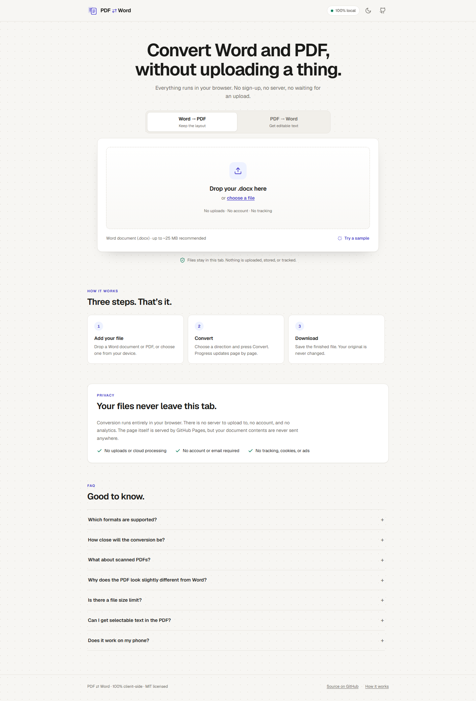

# PDF ⇄ Word

A fast, private Word ↔ PDF converter that runs entirely in your browser.

**Live app:** https://andrewung2009.github.io/pdf-word-converter/



### Conversion result


## Why this exists

Most online converters upload your documents to a server. This one doesn't. The app is a static site hosted on GitHub Pages, and every conversion happens inside your browser tab. No account, no uploads, no tracking, no ads.

## Features

- **Word → PDF** — keeps page layout, tables, lists, and images close to the original.
- **PDF → Word** — rebuilds editable text, headings, lists, and alignment; an exact-layout (image) mode is available for design-heavy or scanned PDFs.
- **Selectable-text PDFs** — after a Word conversion, use **Print / Save as PDF** to produce a high-quality PDF with real text.
- **Everything stays local** — no server, no file uploads, no analytics.
- **Fast and focused** — one file, one click, page-by-page progress, and cancel at any time.
- **Friendly edge cases** — encrypted PDF password prompt, scanned-PDF detection, legacy `.doc` guidance, size warnings, and clear errors.
- **Light and dark themes**, responsive layout, keyboard support, and reduced-motion support.
- **Works at any GitHub Pages path** — relative asset URLs.

## How to use

1. Pick a direction: **Word → PDF** or **PDF → Word**.
2. Drop a `.docx` or `.pdf` file, or choose one. You can also try the bundled sample.
3. Press **Convert** (PDF → Word lets you choose editable text or exact layout).
4. Download the result. Your original file is never modified.

PDF → Word creates a new `.docx` you can open in Microsoft Word, Google Docs, LibreOffice, or Pages.

## How it works

### Word → PDF

The `.docx` is rendered in the browser with `docx-preview`, using metric-compatible fonts where possible. Each page is captured at high resolution and assembled into a PDF with `jsPDF`. Because browsers cannot generate a vector PDF from a Word layout without a server, the downloaded PDF is page-accurate but image-based. Use **Print / Save as PDF** if you need selectable text.

### PDF → Word

`pdf.js` extracts the text layer and positions. Lines, words, headings, alignment, and simple lists are reconstructed into real Word paragraphs with the `docx` library. Complex multi-column layouts may not match exactly. If the PDF has no text layer (a scan), the app detects it and offers **Exact layout (images)** mode, which embeds each page as an image in Word.

## Privacy

- Files are read with the browser's `File` APIs and never leave the device.
- There is no backend and no upload endpoint.
- No cookies, analytics, ads, or third-party trackers.
- The app is a static bundle served by GitHub Pages; bundled libraries and document fonts are self-hosted.
- Only the theme and last-used mode are saved in `localStorage`.

## Supported formats and limits

- **Word:** modern `.docx` only. Legacy `.doc` files must be saved as `.docx` first.
- **PDF:** standard PDFs, including password-protected PDFs (you'll be prompted).
- **Size:** no server limit. Around 25 MB or 200 pages is a comfortable range; very large files depend on available device memory. Files over 100 MB are blocked with a clear message.
- **OCR:** not included. Scanned PDFs are detected and can be converted in exact-layout mode.
- **Browsers:** current Chrome, Edge, Firefox, and Safari.

## Local development

Requires **Node.js 22.13+**.

```bash
npm install
npm run dev
```

Build and preview the production bundle:

```bash
npm run build
npm run preview
```

Regenerate the bundled sample files:

```bash
npm run samples
```

## Testing

```bash
npm test          # unit tests for text layout and file helpers
npm run test:e2e  # production build + Playwright browser tests
npx playwright install chromium   # first run only
```

The end-to-end tests exercise Word → PDF, PDF → Word, scanned-PDF detection and image fallback, legacy `.doc` handling, dark mode, and mobile layout.

## Deployment

The site is deployed to the `gh-pages` branch and served by GitHub Pages.

```bash
npm run deploy
```

This builds the production bundle and pushes it to `gh-pages` using the `gh-pages` package. In the repository:

1. Open **Settings → Pages**.
2. Set **Source** to **Deploy from a branch**.
3. Choose the **gh-pages** branch and the **/ (root)** folder.
4. Run `npm run deploy` after changes. The live URL appears on the Pages settings page.

The Vite `base` is `./`, so the site works both at `username.github.io/repo/` and at a custom domain.

If you prefer GitHub Actions, add a Pages workflow after granting your CLI the `workflow` scope (`gh auth refresh -s workflow`). The static output is the same.

## Project structure

```text
index.html                  UI shell and static content
src/main.ts                 app state, interactions, progress, result flow
src/styles.css              design tokens and responsive styling
src/converters/pdfToDocx.ts PDF text/image → .docx
src/converters/docxToPdf.ts .docx render → PDF + print route
src/converters/textLayout.ts text line/heading/list reconstruction
src/lib/                    file detection, helpers, PDF.js loader
public/samples/             bundled sample documents
e2e/                        Playwright conversion tests
tests/                      Vitest unit tests
public/                     favicon, theme bootstrap, samples, social image
```

## Credits

Design inspiration: [Squoosh](https://github.com/GoogleChromeLabs/squoosh), [Stirling-PDF](https://github.com/Stirling-Tools/Stirling-PDF), [Documenso](https://github.com/documenso/documenso), [DocuSeal](https://github.com/docusealco/docuseal), [Omatsuri](https://github.com/rtivital/omatsuri), [it-tools](https://github.com/CorentinTh/it-tools), and [shadcn/ui](https://github.com/shadcn-ui/ui). No code was copied from those projects.

Libraries and assets:

- [PDF.js](https://github.com/mozilla/pdf.js) — Apache-2.0
- [docx](https://github.com/dolanmiu/docx) — MIT
- [docx-preview](https://github.com/VolodymyrBaydalka/docxjs) — Apache-2.0
- [jsPDF](https://github.com/parallax/jsPDF) — MIT
- [html2canvas-pro](https://github.com/yorickshan/html2canvas-pro) — MIT
- [pdf-lib](https://github.com/Hopding/pdf-lib) — MIT (sample generation only)
- Geist, Carlito, and Caladea fonts via [Fontsource](https://fontsource.org/) — SIL Open Font License
- Icons adapted from [Lucide](https://lucide.dev/) — ISC

## License

MIT © 2026 Andrew Ung
